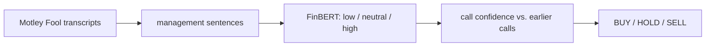

# Fintrax

Fintrax scores how confident management sounds on earnings calls and turns that into BUY / HOLD / SELL signals.

It pulls transcripts from The Motley Fool, runs every management sentence through a fine-tuned FinBERT model (low / neutral / high confidence), and averages those into one confidence score per call. Each call is then compared against all the calls that came before it. If a call sounds noticeably more confident than usual it's a BUY, noticeably less confident is a SELL, and everything else is a HOLD.

**Where things are (Oct 2026):** I'm currently running it on the full archive, about 53.6k transcripts from 2017 to now. Once the download finishes the model gets retrained and every call is rescored. Everything below is from the pilot run (202 calls, 30 large caps, 2024–26), so expect the numbers and charts to change.



## Output

The main output is `results/signals.csv`, one row per call:

- `signal`: BUY, HOLD or SELL
- `confidence`: average of P(high) − P(low) across management sentences, so −1 is all hedging and +1 is all certainty
- `confidence_z`: how that compares to every earlier call, in standard deviations. This is what the signal is based on.
- `conf_prepared` / `conf_qna`: confidence in the scripted remarks vs. the Q&A
- `gap`: Q&A minus prepared, i.e. how much the tone drops once they're off-script (just for context)
- `pct_high` / `pct_low`: share of sentences classified high / low
- `confidence_change`: change from the company's previous call

The thresholds are in `config.yaml` under `signals`. Right now it's BUY if `confidence_z > 0.5`, SELL if `< -0.5`, HOLD otherwise. The z-score only uses calls dated before the one being scored so there's no lookahead, and the first 20 calls are skipped as warm-up.

`results/latest_signals.csv` has the strongest BUYs and SELLs from the last 45 days:


### Per-stock charts

Each stock gets a chart (`results/signal_charts/{TICKER}.png`, plus `signal_grid.png` with all of them). The top panel is price with green ▲ for BUY calls and red ▼ for SELL calls, and the bottom panel is each call's z-score with the BUY/SELL zones shaded.


One thing that stands out: some companies just talk differently. In the pilot NVDA was almost always a BUY and JPM almost always a SELL. That's because the comparison is against all earlier calls, not the company's own history. If you want to see whether a specific company's tone shifted, look at `confidence_change` instead.

### Market-wide

`confidence_distribution.png` shows the BUY/HOLD/SELL split and plots prepared vs. Q&A confidence:


`confidence_index.png` is average confidence across all calls by quarter, along with the share of BUYs and SELLs:


Almost every call is less confident in Q&A than in the prepared remarks (most points sit below the dashed line). In the pilot, hedging sentences went from 12% of prepared remarks to 31% of Q&A, which makes sense since the prepared part is basically written by IR.

## The model

There's no labeled dataset for "how confident does this executive sound," so I made weak labels with the [Loughran-McDonald](https://sraf.nd.edu/loughranmcdonald-master-dictionary/) word lists plus some spoken hedges and certainty phrases I added. (The LM dictionary is academic-use only, so it gets downloaded at runtime and isn't in the repo.)

Rough scoring per sentence:

| Cue | Examples | Weight |
|---|---|---|
| Strong modal | definitely, clearly, never, always | +1 (*will* is +0.5) |
| Certainty phrase | confident, on track, committed to, clear line of sight | +1 |
| Weak modal / uncertainty | may, might, could, perhaps, depend | −1 |
| Moderate modal | likely, probably, should, would | −0.5 |
| Hedge phrase | too early to tell, hard to say, kind of, we'll see | −1 |
| Soft hedge | I think, we believe | −0.5 |

Net score ≥ 1 is high, ≤ −1 is low, no cues at all is neutral. Mixed sentences are thrown out of training. Only management sentences are used; analysts, operators and the safe-harbor boilerplate get filtered out.

Then [`ProsusAI/finbert`](https://huggingface.co/ProsusAI/finbert) gets a new 3-class head and is fine-tuned on up to 860k class-balanced sentences. Train/val/test are split by call so the same call never shows up in two splits. Training runs in bf16 on my Mac (MPS).

Pilot results: 99.1% test accuracy / 0.991 macro-F1 against the weak labels, vs. a 42.9% majority-class baseline. That number is inflated since the model is basically learning the lexicon, so I also tried deleting every lexicon word from the test sentences. It still separates low from high at AUC 0.67, which means it picked up some context beyond the word lists, but honestly it's mostly a smoother version of them.

## Pipeline

- `scrape.py`: walks fool.com's monthly sitemaps back to 2017 and grabs every earnings call transcript URL. Rate-limited to 1.5 req/s and resumable. Ticker, company and fiscal quarter come from the page.
- `parse.py`: handles the three different page layouts Motley Fool has used (2017–18, ~2019–25, 2025+). Splits prepared remarks from Q&A, pulls the actual call date from the page (the date in the URL is when it was published), labels speakers, and drops duplicates and calls with under 500 management words in either section.
- `dataset.py`, `lexicon.py`: sentence splitting and weak labels
- `train.py`: fine-tuning plus the test/context checks
- `score.py`: scores every sentence in fp16 (resumable) and aggregates per call
- `signals.py`, `report.py`: signals and charts

## Does it actually work?

`python -m fintrax backtest` (not included in `all`) checks how the signals played out and writes to `results/evaluation/`. It looks at excess return vs. SPY at 1/5/20/60 days after each call (t-stats clustered by month), returns by confidence quintile within each quarter, and a simple long-only inventory sim where a BUY adds a $1,000 lot (up to 5 per stock) and a SELL exits, compared against putting the same money in SPY.

Short answer for the pilot (182 tradeable calls): no, not detectably.

| Horizon | BUY − SELL (monthly) | Top − bottom quintile |
|---|---|---|
| 1 day | +0.24% (t = 0.33) | +0.98% (t = 1.17) |
| 5 days | −0.55% (t = −0.46) | +0.07% (t = 0.05) |
| 20 days | −1.66% (t = −0.83) | −3.27% (t = −1.58) |
| 60 days | +1.25% (t = 0.34) | +2.18% (t = 0.44) |

The inventory sim did beat SPY (+$27.7k vs. +$13.2k), but don't read into that. It was mostly holding mega-cap tech during a strong market and only sold twice. The full archive should give a much better answer.

## Caveats

- "Confidence" here means certainty language according to a word list, not what management actually believes.
- Calls are compared against every company, so naturally upbeat or cautious companies lean BUY or SELL. Per-company baselines would probably be fairer and are on the list.
- Motley Fool transcripts are machine-assisted, and calls where speakers are merged or unlabeled get dropped.
- The backtest has survivorship bias (Yahoo Finance is missing a lot of delisted tickers) and ignores transaction costs.

## Running it

```sh
make setup                 # venv + requirements
make scrape                # ~10 h for the full archive at 1.5 req/s, resumable
make parse label train     # training takes ~1 h on Apple Silicon or a GPU
make score                 # ~4 h for ~14M sentences, resumable
make signals               # signals.csv, latest_signals, charts
make backtest              # optional
make test                  # 32 tests
```

Settings are all in [`config.yaml`](config.yaml). Transcripts are © The Motley Fool, so `data/` and `models/` are gitignored and the tests run on synthetic fixtures.

Research project, not investment advice.
