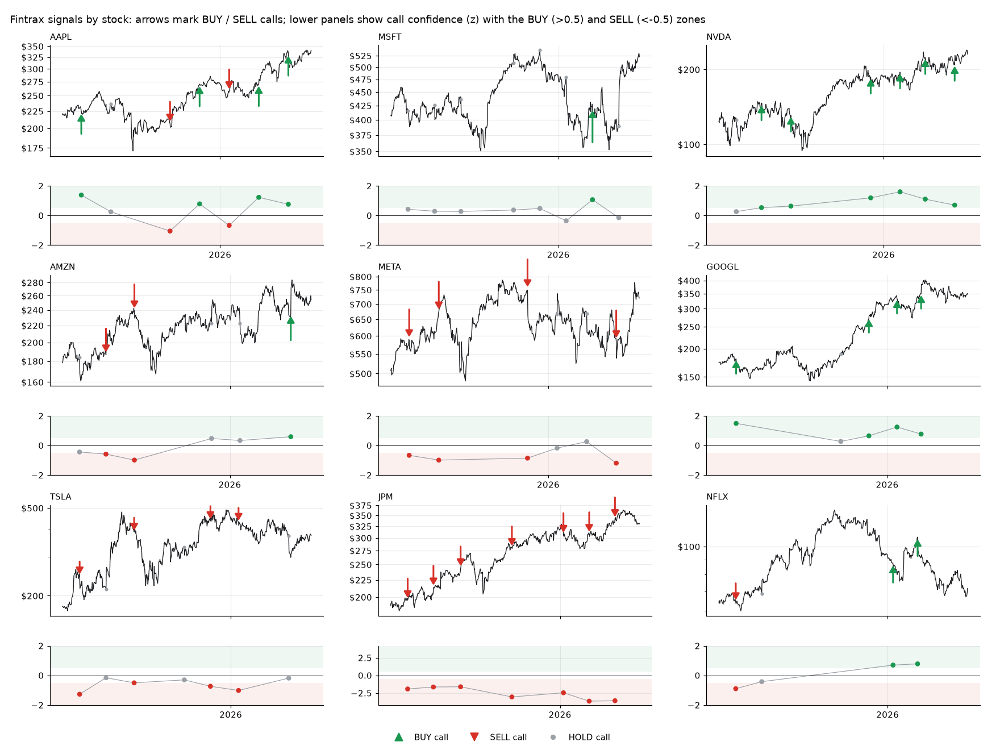

# fintrax

Scores how confident management sounds on earnings calls and turns that into BUY/HOLD/SELL signals.

Transcripts are scraped from the Motley Fool. Each management sentence gets classified as low/neutral/high confidence by a fine-tuned FinBERT, and the scores are averaged per call. The call score is z-scored against all earlier calls: above +0.5 is BUY, below -0.5 is SELL, otherwise HOLD.

Right now I'm scraping the full archive (~53k transcripts since 2017) and will retrain after. Everything below is from a smaller pilot run (202 calls, 30 large caps, 2024-26) so the numbers will change.



### How it works

There's no labeled data for this so I made weak labels using the [Loughran-McDonald](https://sraf.nd.edu/loughranmcdonald-master-dictionary/) word lists (strong/weak modals, uncertainty words) plus a bunch of hedge and certainty phrases from listening to calls ("too early to tell", "on track", "kind of", etc). Sentences that lean clearly one way get labeled high or low, no cues = neutral, mixed ones get thrown out. Then FinBERT gets fine-tuned on that.

It gets 99% test accuracy but that's against the weak labels so it mostly just means it learned the word list. When I strip all the lexicon words out of the test sentences it still gets 0.67 AUC on low vs high, so it's picking up a little beyond the dictionary, not a lot.

Output goes to `results/signals.csv` (one row per call with the signal, confidence, z-score, prepared vs Q&A confidence, and change since last call). Thresholds are in `config.yaml`.

Some things I noticed in the pilot: Q&A is less confident than prepared remarks on almost every call (31% hedging sentences vs 12%). And since calls are compared against all companies, some tickers basically always get the same signal (NVDA was almost always BUY, JPM almost always SELL).

### Backtest

`make backtest` looks at returns vs SPY 1/5/20/60 days after each call, and runs a simple long-only sim (BUY adds $1k up to 5 lots, SELL exits). On the pilot nothing was significant. The sim beat SPY ($27.7k vs $13.2k) but that's just from holding big tech in a good market, it only sold twice.

### Running

```sh
make setup
make scrape              # ~10h for everything, resumable
make parse label train   # train takes ~1h on an M-series mac
make score               # ~4h, resumable
make signals
make backtest            # optional
make test
```

`data/` and `models/` aren't committed since the transcripts are Motley Fool's. The LM dictionary is academic-use only so it gets downloaded when you run it.

Known issues: "confidence" here really just means certainty language, the pooled z-score favors companies that always sound upbeat (should try per-company baselines), and the backtest has survivorship bias and no transaction costs.

Not investment advice obviously.
