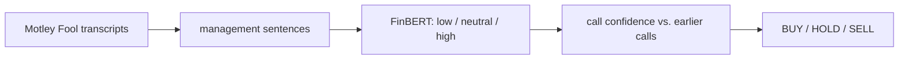
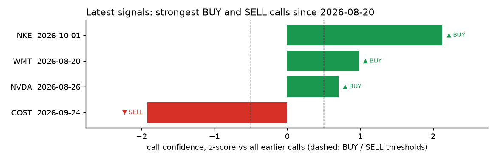
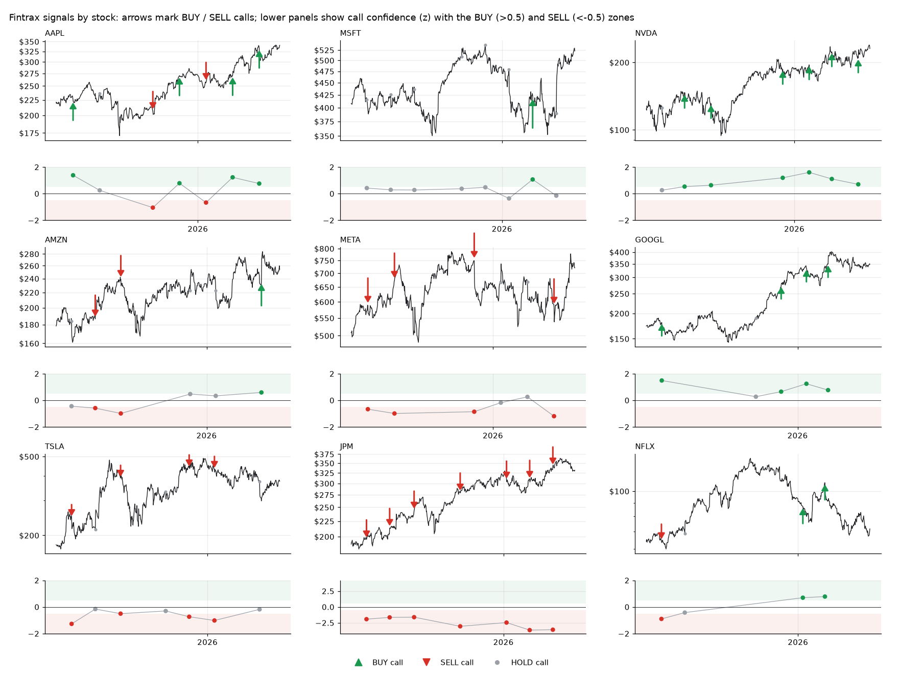
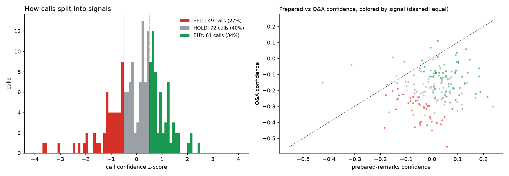
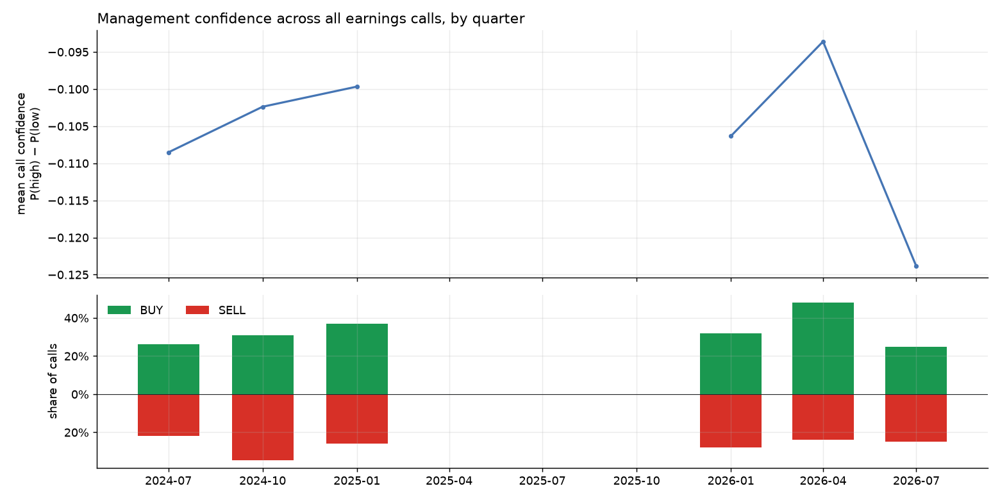

# Fintrax

Scores how confident management sounds on earnings calls and generates BUY/HOLD/SELL signals from it.

Transcripts come from The Motley Fool. Every management sentence goes through a fine-tuned FinBERT classifier (low/neutral/high confidence), and the sentence scores get averaged into a score for the call. That score is z-scored against all earlier calls: above +0.5 is a BUY, below -0.5 is a SELL, anything else is HOLD.

Currently scraping the full archive (~53.6k transcripts, 2017 to now). After that I'll retrain and rescore everything. The numbers and charts below are from a pilot of 202 calls (30 large caps, 2024-26) and will change.



## Output

`results/signals.csv`, one row per call. Columns:

- `signal` - BUY / HOLD / SELL
- `confidence` - mean of P(high) - P(low) over management sentences, -1 to +1
- `confidence_z` - z-score vs. all earlier calls (the signal uses this)
- `conf_prepared`, `conf_qna` - confidence in prepared remarks and in Q&A
- `gap` - Q&A minus prepared
- `pct_high`, `pct_low` - fraction of high / low sentences
- `confidence_change` - change since the company's last call

Thresholds are in `config.yaml` under `signals`. Only calls before the current one go into the z-score, and the first 20 calls are warm-up.

`results/latest_signals.csv` has the strongest BUYs and SELLs from the last 45 days.



There's also a chart per ticker in `results/signal_charts/` (price on top with BUY/SELL markers, z-score below) and a grid of all of them:



Since calls are compared against every company and not the company's own history, some tickers lean one way. In the pilot NVDA was nearly always BUY and JPM nearly always SELL. Use `confidence_change` to see shifts within one company.





Q&A is less confident than prepared remarks on pretty much every call. In the pilot, 12% of prepared-remarks sentences were hedging vs. 31% in Q&A.

## Model

I couldn't find any labeled data for this, so the labels are weak labels from the [Loughran-McDonald](https://sraf.nd.edu/loughranmcdonald-master-dictionary/) word lists plus some hedge/certainty phrases I added. LM is academic-use only so it's downloaded at runtime, not committed.

| Cue | Examples | Weight |
|---|---|---|
| Strong modal | definitely, clearly, never, always | +1 (will = +0.5) |
| Certainty phrase | confident, on track, committed to, clear line of sight | +1 |
| Weak modal / uncertainty | may, might, could, perhaps, depend | -1 |
| Moderate modal | likely, probably, should, would | -0.5 |
| Hedge phrase | too early to tell, hard to say, kind of, we'll see | -1 |
| Soft hedge | I think, we believe | -0.5 |

Net >= 1 is high, <= -1 is low, no cues is neutral. Mixed sentences are left out of training. Analyst questions, operator lines and safe-harbor boilerplate are filtered out first.

[`ProsusAI/finbert`](https://huggingface.co/ProsusAI/finbert) with a new 3-class head, fine-tuned on up to 860k class-balanced sentences. Splits are by call. bf16 on MPS.

Pilot: 99.1% test accuracy, 0.991 macro-F1 (majority baseline 42.9%). That's against the weak labels, so it mostly shows the model learned the lexicon. With all lexicon words removed from the test sentences it still gets AUC 0.67 on low vs. high, so there's some signal beyond the word lists but not a lot.

## Pipeline

- `scrape.py` - pulls transcript URLs from fool.com's monthly sitemaps (2017+), 1.5 req/s, resumable
- `parse.py` - handles the 3 page layouts (2017-18, ~2019-25, 2025+), splits prepared remarks / Q&A, gets the real call date from the page (URL date is the publish date), labels speakers, drops duplicates and calls with < 500 management words in either section
- `dataset.py`, `lexicon.py` - sentence splitting, weak labels
- `train.py` - fine-tuning, test set + lexicon-removed check
- `score.py` - fp16 scoring, resumable, per-call aggregates
- `signals.py`, `report.py` - signals and charts

## Backtest

`python -m fintrax backtest` (not part of `all`), output in `results/evaluation/`. Looks at excess return vs. SPY 1/5/20/60 days after each call (t-stats clustered by month), returns by confidence quintile within each quarter, and a long-only sim: BUY adds a $1,000 lot (max 5 per stock), SELL exits, compared to the same dollars in SPY.

Pilot, 182 tradeable calls - nothing significant:

| Horizon | BUY - SELL (monthly) | Top - bottom quintile |
|---|---|---|
| 1d | +0.24% (t=0.33) | +0.98% (t=1.17) |
| 5d | -0.55% (t=-0.46) | +0.07% (t=0.05) |
| 20d | -1.66% (t=-0.83) | -3.27% (t=-1.58) |
| 60d | +1.25% (t=0.34) | +2.18% (t=0.44) |

The sim made +$27.7k vs. +$13.2k for SPY, but that's mostly from holding big tech in a good market (it only exited twice), not the signal.

## Known issues

- "Confidence" is certainty language per a word list, not actual conviction
- Pooled z-scores favor companies that always sound upbeat. Should probably try per-company baselines
- Motley Fool transcripts are machine-assisted; calls with merged/unlabeled speakers are dropped
- Backtest has survivorship bias (yfinance is missing a lot of delisted tickers) and no transaction costs

## Running

```sh
make setup
make scrape              # ~10h for the full archive, resumable
make parse label train   # train is ~1h on Apple Silicon
make score               # ~4h for ~14M sentences, resumable
make signals
make backtest            # optional
make test
```

For what to rerun after a change, and a block-by-block explanation of why the code is written the way it is, see [`docs/CODE_WALKTHROUGH.md`](docs/CODE_WALKTHROUGH.md).

Config is in [`config.yaml`](config.yaml). `data/` and `models/` are gitignored since the transcripts are © The Motley Fool. Tests use synthetic fixtures.

Not investment advice.
